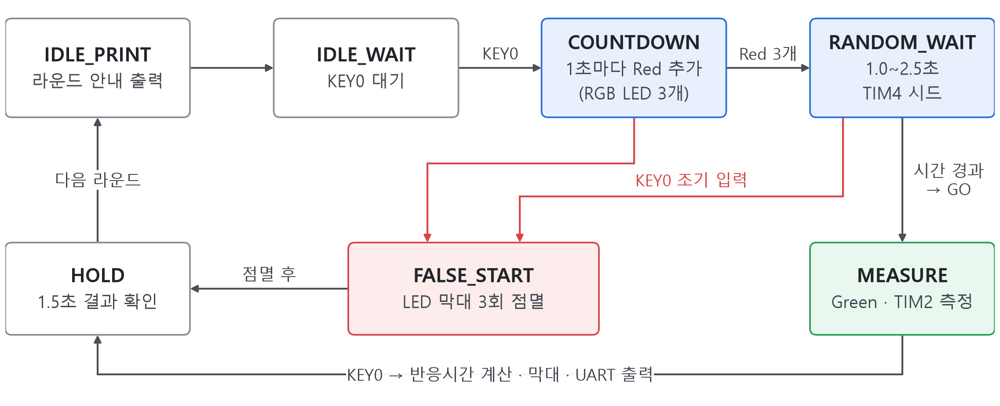
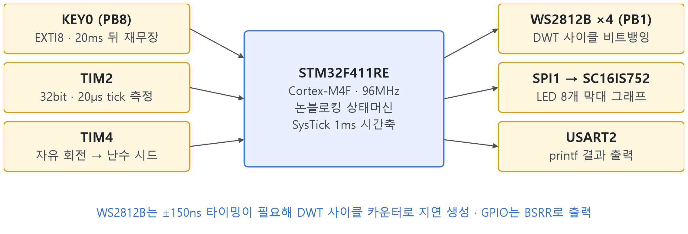

# 🏁 F1 Start Light — STM32 반응속도 게임 (RGB LED · Non-blocking)

> F1 레이스 출발 신호를 모사한 **반응속도 측정 게임**입니다. RGB LED가 빨간색으로 하나씩 켜진 뒤 **초록색으로 바뀌는 순간(GO)** 부터 버튼을 누를 때까지의 시간을 측정해 LED 막대그래프와 UART로 보여 줍니다.
> HAL·RTOS 없이 **레지스터를 직접 제어**하며, 메인 루프가 한 번도 멈추지 않는 **논블로킹 상태머신**으로 작성했습니다.
> *AI 시스템반도체 SW개발자 2기 (대한상공회의소) · Cortex-M4 파이널 프로젝트 · 개인*


> 처음 만든 SPI LED 카운트다운 · blocking 버전은 [`v1-spi-led`](../../tree/v1-spi-led) 브랜치에 보관했습니다.

## 🎮 게임 규칙

1. `KEY0`을 누르면 라운드 시작
2. RGB LED 3개(U1·U3·U4)가 **1초 간격으로 빨간색 순차 점등** (카운트다운)
3. **1.0 ~ 2.5초 랜덤 대기** 후 3개 모두 **초록색으로 전환 = GO!**
4. GO 직후 `KEY0`을 누르면 반응시간(ms)을 UART로 출력하고 8개 LED 막대로 표시 (50ms 단위 1레벨, 빠를수록 많이 점등), 최고 기록 갱신
5. 카운트다운·랜덤 대기 중 버튼을 누르면 **False Start** (LED 막대 3회 점멸)

## 🔁 상태머신



| 상태 | 동작 | 다음 상태 |
|---|---|---|
| `ST_IDLE_PRINT` | 라운드 안내 출력, 버튼 재무장 | `ST_IDLE_WAIT` |
| `ST_IDLE_WAIT` | KEY0 대기 | KEY0 → `ST_COUNTDOWN` |
| `ST_COUNTDOWN` | 1초마다 Red LED 추가 | 3개 완료 → `ST_RANDOM_WAIT` / KEY0 → `ST_FALSE_START` |
| `ST_RANDOM_WAIT` | 1.0~2.5초 대기 (TIM4 시드) | 시간 경과 → Green + TIM2 시작 → `ST_MEASURE` / KEY0 → `ST_FALSE_START` |
| `ST_MEASURE` | 반응시간 측정 중 | KEY0 → 결과 출력 → `ST_HOLD` |
| `ST_FALSE_START` | LED 막대 150ms 간격 3회 점멸 | `ST_HOLD` |
| `ST_HOLD` | 1.5초 결과 확인 | `ST_IDLE_PRINT` |

## 🧩 하드웨어 · 주변장치 구성



| 핀 | 용도 | 비고 |
|---|---|---|
| **PB1** | WS2812B DIN (LED 4개 캐스케이드, 3개 사용) | PB0이 기존 부저 PWM과 겹쳐 이동 |
| **PB8** | KEY0 (EXTI8) | Pull-Down, Active High, 상승엣지 |
| **PB3 / PB4 / PB5** | SPI1 SCK / MISO / MOSI (AF05) | SC16IS752 GPIO 확장 |
| **PA8** | SPI1 nCS | GPIO 소프트웨어 제어 |
| **PA2 / PA3** | USART2 TX / RX | 115200bps, ST-Link 경유 |
| **PA5** | 보드 LED | 250ms 하트비트 (메인 루프 동작 확인) |

| 자원 | 역할 |
|---|---|
| SysTick | 1ms 인터럽트로 `g_tick_ms` 증가 → 상태머신의 시간축 |
| TIM2 | 반응시간 스톱워치 (20µs tick, **32bit**) |
| TIM4 | 계속 자유 회전, 랜덤 대기 직전의 `CNT`를 난수 시드로 사용 |
| DWT | WS2812B 비트 펄스용 사이클 카운터 (1 cycle ≈ 10.4ns) |

## ⭐ 핵심 구현

### 1. 논블로킹 상태머신

`TIM2_Delay()`, `while(!Key_Pressed)` 같은 대기 코드를 모두 없애고, SysTick 1ms를 시간축으로 **"기다린다"를 "지났는지 확인한다"로** 바꿨습니다.

```c
#define ELAPSED(since)   ((unsigned int)(g_tick_ms - (since)))   // unsigned 뺄셈 → 오버플로우에도 안전

case ST_COUNTDOWN:
    if(Key_Take()) { Enter_False_Start(); break; }
    if(ELAPSED(phase_ms) >= COUNTDOWN_STEP_MS) { /* 다음 Red 점등 또는 RANDOM_WAIT */ }
    break;
```

```c
for(;;)
{
    Key_Service();      // 채터링 재무장 처리
    Game_Step();        // 상태머신 1스텝
    Heartbeat_Step();   // PA5 LED 250ms 토글
}
```

### 2. 버튼 입력 — EXTI + 논블로킹 디바운싱

ISR은 눌림을 감지하면 EXTI를 마스킹하고 플래그만 세팅합니다. 메인이 `Key_Take()`로 입력을 소비하면 20ms 뒤 재무장을 예약하고, `Key_Service()`가 매 루프 예약 시간을 확인해 재무장합니다.

```c
void EXTI9_5_IRQHandler(void)
{
    EXTI->PR = (0x1 << 8);            // Pending Clear
    Macro_Clear_Bit(EXTI->IMR, 8);    // 재무장 전까지 인터럽트 차단 (채터링 방지)
    Key_Pressed = 1;                  // 플래그만 세팅
}
```

### 3. WS2812B RGB LED

수업 예제(`DMA_EX_RGB_LED`)의 WS2812B 드라이버를 이식해 사용했습니다. 0/1 비트를 ±150ns 이내의 펄스 폭으로 보내야 해서 **DWT 사이클 카운터**로 지연을 만들고, GPIO는 `ODR`(Read-Modify-Write) 대신 **`BSRR`** 단일 쓰기로 출력합니다. 24비트 색 데이터를 보내는 동안에는 인터럽트를 막습니다.

```c
#define WS2812_T0H_CYCLE  (unsigned int)(0.40 * (SYSCLK/1000000.0))   // ≈ 38 cycles

static void WS2812_Delay_Cycle(unsigned int cycle)
{
    unsigned int start = DWT->CYCCNT;
    while((DWT->CYCCNT - start) < cycle);
}
```

### 4. 결과 표시

SPI1으로 SC16IS752 GPIO 확장기를 제어해 LED 8개 막대그래프를 표시합니다. 확장기 출력이 Active-Low라서 반전 처리는 `LED_Show(on_mask)` 한 곳에서만 합니다.

## 🐞 트러블슈팅

| 문제 | 원인 | 해결 |
|---|---|---|
| 반응이 1.31초를 넘으면 `0ms`로 표시 | TIM2 최댓값을 16bit(`0xFFFF`)로 두어 20µs × 65536 = 1.31초에서 카운터가 멈추고 다시 로드됨 | 레퍼런스 매뉴얼로 TIM2가 **32bit** 타이머임을 확인 → `TIM2_MAX`를 `0xFFFFFFFF`로 확장 |
| 몇 라운드 뒤 버튼이 완전히 먹통 | ISR에서 막아 둔 EXTI가, 입력을 쓰지 않는 구간(결과 확인 1.5초)에서 눌리면 재무장되지 않고 막힌 채로 남음 | 새로 입력을 기다리기 시작하는 지점(라운드 안내, GO 직전)에서 `Key_Arm_Now()`로 강제 재무장 |
| WS2812B 핀 충돌 | 이식한 드라이버가 가정한 PB0이 당시 부저 PWM(TIM3) 출력과 겹침 | GPIO 사용 현황을 확인해 비어 있는 PB1로 이동 (이후 부저 기능은 제거) |
| 리셋 직후 LED 색이 의도와 다르게 켜짐 | GPIO가 설정되기 전 DIN 핀이 떠 있어 노이즈를 데이터로 받을 수 있음 | DIN 핀 Pull-Down, 초기화 시 긴 RESET(60us × 3)으로 재동기화 |

```diff
- #define TIM2_MAX  (0xffffu)
+ #define TIM2_MAX  (0xffffffffu)   // TIM2는 32bit 카운터 -> 1.31초 제한 해제
```

## 📁 파일 구성

| 파일 | 역할 |
|---|---|
| `main.c` | 게임 상태머신, 버튼 재무장, SysTick 핸들러 |
| `ws2812.c` | WS2812B 드라이버 (DWT 사이클 기반, 수업 예제 이식) |
| `timer.c` | TIM2 스톱워치 / TIM4 |
| `spi.c` | SPI1 → SC16IS752 GPIO 확장 |
| `key.c` | KEY0 EXTI 설정 |
| `uart.c`, `clock.c`, `led.c`, `adc.c`, `i2c.c`, `systick.c` | 주변장치 |
| `crt0.s`, `rom_0x08000000.lds`, CMSIS 헤더 | 시작 코드 / 링커 / 헤더 (수업 제공) |

## 🚀 빌드 및 실행

```bash
make        # arm-none-eabi-gcc → rom_0x08000000.elf / .bin (Makefile의 TOOL_DIR을 환경에 맞게 수정)
make run    # STM32CubeProgrammer로 다운로드
```

UART 터미널(115200)에서 `[Round N] Press KEY0 to start...`가 보이면 정상입니다.

## 💡 배운 점

- 레퍼런스 매뉴얼을 근거로 판단하는 습관 — 카운터 비트 폭 같은 문제는 추측보다 문서 대조가 빠름
- `while(!flag)` 구조를 상태머신으로 바꾸면서 새로 생기는 엣지 케이스(인터럽트 재무장 시점)를 다루는 방법
- 나노초 단위 타이밍이 필요한 장치는 일반 타이머 대신 코어 사이클 카운터로 다루고, 이식한 코드는 핀 사용 현황부터 대조해야 한다는 점
